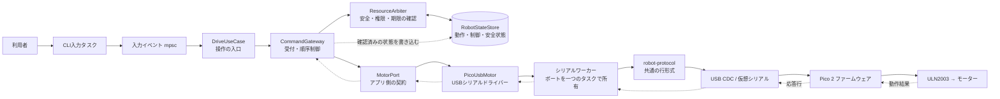
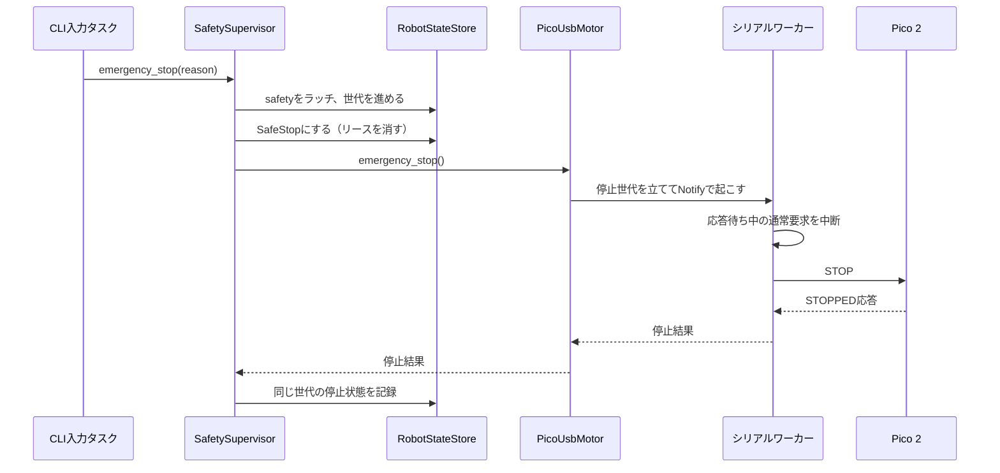

# 通信・状態管理・Tokio入門

この文書では、このレポジトリで実際に使っている通信方法、状態の持ち方、Tokioによる非同期処理を、Rustやロボット開発が初めての人向けに説明します。用語の一般的な意味だけでなく、「このコードではどこで、なぜ使うのか」「新しい入力経路を追加するときにどう使うのか」も紹介します。

## まず全体像

現在動作する経路は、CLIからPico 2のモーターへUSBシリアルで指令を送り、返ってきた状態をアプリケーション内に反映するものです。



矢印が示すとおり、CLIはUSBのバイト列を直接作りません。ロボット操作の依頼をアプリケーションに渡し、デバイス固有の通信はアダプターに任せます。この分け方により、将来CLI以外の入力元を足す場合も、USBの詳細を各入力元にコピーせずに済みます。

実装されているのはCLIとPico USBモーターの経路です。ROS 2、Autoware、カメラ、LiDAR、ネットワークRPCは、今後接続するための拡張先であり、現時点の動作機能ではありません。

## 1. 「通信」は3つの範囲に分けて考える

このレポジトリには、性質の異なる通信が3種類あります。

| 範囲 | 何をやりとりするか | 実装 |
|---|---|---|
| アプリケーションの境界 | 「前進して」「状態を読んで」などのロボット操作 | `DriveControl`、`MotorPort` というRustのtrait（契約） |
| 同一プロセス内のタスク間 | 入力イベント、デバイス要求、完了通知 | Tokioの `mpsc`、`oneshot`、`watch`、`Notify` |
| コンピューターとマイコン間 | モーター指令と確認済み状態 | USB CDC上の行単位ASCIIシリアルプロトコル |

ここでいう「通信」は、すべてがネットワーク通信という意味ではありません。現在の機器通信はUSBケーブル上のシリアル通信で、アプリ内の要求はメモリー上のキューを通ります。

### 1.1 アプリケーションのtraitは「頼み方の約束」

`DriveControl` は、入力元が使う操作の約束です。制御権の取得・更新・解放、前進・後退・停止、非常停止、状態取得などを定義しています。CLIや将来の別の入力アダプターは、この約束を呼び出します。

一方 `MotorPort` は、アプリケーションがモーター装置に求める約束です。USBドライバーがこれを実装します。アプリケーションは「方向を設定して、装置が返す状態を待つ」とだけ知っていればよく、USBポート名やバイト列を知る必要はありません。

```text
CLI / 将来のROS 2入力
          │ DriveControl
          ▼
   アプリケーション
          │ MotorPort
          ▼
     USBドライバー
```

traitを境界に置く理由は、操作の意味と機器のつなぎ方を分けるためです。たとえば、USBドライバーを交換しても `DriveUseCase` の責務は変わりません。別の入力アダプターも同じ `DriveControl` を利用できます。

これらのtraitのうちI/Oを待つメソッドは `async` です。`async_trait` は、非同期メソッドをtraitオブジェクト（このコードでは `Arc<dyn DriveControl>` など）として使うために用いています。

### 1.2 プロセス内で使うTokioの通信手段

Tokioのチャネルは、同じプログラム内のタスク間で値を渡す道具です。デバイスの外へ送られるパケットではありません。

| 手段 | たとえ・性質 | このレポジトリでの用途 |
|---|---|---|
| `mpsc` | 複数の送り手から、ひとつの受け手へ順に渡すキュー | CLI入力イベント、指令ゲートウェイの要求、USBワーカーの仕事依頼 |
| `oneshot` | 1回だけ使う返信用の封筒 | キューに仕事を入れた呼び出し元へ、成功・失敗や状態を返す |
| `watch` | 最新値だけを知らせる掲示板 | CLIの終了フラグ。受信側は `true` になったことを知る |
| `Notify` | 値を運ばず「変化があった」と起こすベル | 非常停止を知らせ、シリアル応答待ちを中断する |
| `Arc` / atomic | 参照の共有 / 小さな値の素早い共有 | 状態や停止フラグなどを複数のタスクから参照する |

#### `mpsc`: 仕事を並べるキュー

`mpsc` は複数のproducer（送り手）がひとつのconsumer（受け手）へメッセージを送ります。受け手が一つなので、共有リソースを扱うタスクに要求を集約できます。

このレポジトリでは、容量付きキューが2か所にあります。

- CLI入力キューは容量32です。入力タスクがコマンドを送り、メインタスクが処理します。満杯なら通常コマンドは捨て、`s`（通常停止）は非常停止へ格上げします。
- アプリケーションのコマンドキューも容量32です。満杯のとき `try_send` は待ち続けず、`CommandQueueFull` を返します。コマンドの滞留が際限なく増えるのを防ぎます。

USBドライバー内の仕事キューは `mpsc::unbounded_channel` です。これは容量上限のないキューなので、送り手は空き容量を待ちません。その代わり、使い過ぎると待ち仕事が増え続ける性質があります。通常のモーター操作は上流の容量付きゲートウェイを通す設計で、シリアルポート自体は一つのワーカーだけが扱います。

#### `oneshot`: 要求ごとの返事

「前進を送ったら、Picoの返事も知りたい」というとき、要求のメッセージと一緒に `oneshot::Sender` をキューへ入れます。呼び出し元は対応する `Receiver` を `await` し、その1回の返事を受け取ります。成功時には `MotionState`、失敗時には `ControlError` が返ります。

```text
呼び出し元 ── 要求 + oneshot送信口 ──▶ ワーカー
呼び出し元 ◀──── oneshotで1回返信 ── ワーカー
```

要求の種類は `GatewayRequest` や `Job` というenum（列挙型）で表現されています。たとえば「方向指令」「リース更新」「停止」「状態取得」を、同じキュー上で型安全に区別できます。

#### `watch`: 履歴を残さず最新の状態を伝える

CLIの終了通知は `watch<bool>` です。`q` を入力したタスクが `true` を送り、メインタスクが `changed()` を待っています。古い通知をすべて順番に処理する必要はなく、「終了するかどうか」の最新値だけ知ればよいので `watch` が合います。

コマンド履歴の配送には向きません。履歴を一件ずつ処理する必要があるものには `mpsc` を使います。

#### `Notify` とatomic: 停止要求を待ち時間の外から知らせる

シリアルワーカーがPicoの返事を待っている途中でも非常停止に反応する必要があります。そこで、ドライバーは停止世代をatomic値に記録し、`Notify` で待機中のワーカーを起こします。atomic値は状態を、`Notify` は再確認を促す合図を担います。

これは `mpsc` の通常仕事キューに停止をただ追加するだけの設計とは異なります。通常指令の応答待ちも停止通知で中断できるため、停止が通常指令の完了を待たされにくくなります（ただしUSBや機械そのものが必ず停止できる保証ではありません）。

### 1.3 PicoとのUSBシリアル通信

Linux側ドライバーとPicoファームウェアは、共有crate `robot-protocol` が定める短いASCII行をやりとりします。USB CDCは、USB接続をシリアルポートのように扱う方式です。Linux側では `/dev/ttyACM0`（既定値）を115200 baudで開きます。

要求は「通し番号 + コマンド + 改行」、応答は「同じ通し番号 + 成否 + 装置が報告する状態 + 改行」です。

```text
Linux / Jetson                          Pico 2
    │                                     │
    │  42 FWD\n                          │
    │ ─────────────────────────────────▶ │ 前進指令を実行
    │  42 OK FORWARD\n                    │
    │ ◀───────────────────────────────── │ 現在状態を返信
```

コマンド語は `FWD`、`BACK`、`STOP`、`STATUS`、`PING` です。たとえば停止は `43 STOP\n`、成功応答は `43 OK STOPPED\n` です。`ERR` は装置が要求を受け入れなかったことを表します。

通し番号（sequence number）は、届いた応答がどの要求に対するものかを確認するためにあります。ワーカーは応答行を読み、現在待っている要求と番号が違う行を採用しません。改行単位でフレームを区切るため、両端が同じ共有プロトコルを使えるよう、プロトコルcrateは `no_std` で実装されています。

#### なぜシリアルポートを一つのワーカーに集約するのか

シリアルポートは、送受信の順序が大切な一本のストリームです。複数のタスクが同時に読み書きすると、応答がどの要求に対応するか、どのタスクが何バイト読んだかが曖昧になります。

そこで `PicoUsbMotor` はポートを一つの `serial_worker` タスクに渡し、他のタスクは `Job` をキューへ送ります。ワーカーが一つずつ要求を処理し、応答を確認してから呼び出し元へ返します。ワーカーは要求ごとに650msで応答を打ち切り、書き込みは50ms、ドライバーAPIの応答待ちは最大2秒です。

有効な制御リースがある間は、およそ300msごとに稼働中の方向指令を再送し、停止中なら `PING` を送ってファームウェアの指令タイムアウトを更新します。ファームウェア側には1.5秒の指令タイムアウトがあります。リースが切れたらドライバーが `STOP` を送り、その後は不要な定期通信を止めます。

## 2. 状態管理: 「最後に確認できたこと」を置く

コマンドは「こうしてほしい」という要求、状態は「今こうだと確認できている」という記録です。たとえば「前進せよ」はコマンド、「Picoから `FORWARD` の返事を受け取った」は観測した状態です。要求を送っただけで、成功した状態として記録するわけではありません。

### 2.1 保存する状態と、別管理する健康状態

`RobotStateStore` はプロセス内の共有ストアです。現在のスナップショットには、次の3領域があります。

| 領域 | 内容 | 例 |
|---|---|---|
| `robot` | 装置から報告された動作状態 | 停止・前進・後退 |
| `control` | 制御モードと現在の制御リース | Manual、所有者、リースID、有効期限 |
| `safety` | 非常停止のラッチ（解除まで保持する状態） | 停止中か、理由、停止世代 |

モーターの健康状態（`Ready`、`Degraded`、`Disconnected`）はこのスナップショットに含めず、`DeviceManager` が管理します。健康状態と動作状態は別の問いだからです。「通信できるか」と「モーターがどの方向だと報告したか」は同じ情報ではありません。

カメラ画像やLiDAR点群のような大量データも、この状態ストアに入れていません。現在のスナップショットは少量の制御状態を一貫して読むためのものです。

### 2.2 なぜ読み手と書き手を分けるのか

状態ストアは一つの内部データを共有しますが、利用側へは用途別のハンドルを渡します。

```text
RobotStateStore
  ├─ reader          → スナップショットを読む
  ├─ motion_writer   → 安全世代を確認して動作状態を更新
  ├─ control_writer  → 制御リースやモードを更新
  └─ safety_writer   → 非常停止をラッチ / 条件付き解除
```

この分離は、誤った場所から何でも書き換えないための仕組みです。たとえば、モーション結果を書き込む側が、制御リースや非常停止理由まで直接変更する必要はありません。共有データへの参照は `Arc` で複製し、各領域は `RwLock`、書き手全体は `Mutex` で保護しています。

Rust標準ライブラリの同期ロックを使っているのは、この状態の読み書きが短いメモリー操作だからです。ロックを保持したままUSB応答や `await` を待つ設計にはしていません。デバイスとの非同期I/Oはロックの外で行います。

### 2.3 一貫したスナップショットを読む仕組み

動作、制御、安全の情報は別々のロックに入っています。読み取りの途中で別のタスクが更新すると、「更新前の制御状態」と「更新後の安全状態」を混ぜた読み取りになる可能性があります。

これを避けるため、ストアは `version` を使います。これは「読み取り中に書き込みが割り込まなかったか」を確認する目印です。

```text
書き手: versionを奇数にする → 各状態を変更 → versionを偶数に戻す
読み手: versionを読む → 各状態を読む → versionをもう一度読む
        └─ 同じ偶数なら採用、異なるか奇数なら最初から読み直す
```

書き手どうしは `writer: Mutex<()>` で順番をつけます。読み手は各フィールドの `RwLock` を短時間ずつ読み、前後のバージョンが一致しているときだけ一つの `StateSnapshot` として返します。この方式は「書き手が更新中か」をバージョンの奇数・偶数で表す、seqlock風の仕組みです。

### 2.4 制御リース: 誰がいつまで操作できるか

モーターを操作する権利は `ControlLease`（制御リース）で表します。リースには一意のID、所有者、期限が含まれます。コマンドを出す側は期限を更新し続けることで、制御を保持します。

```text
CLI ── acquire_control ──▶ 3秒のリースを取得
CLI ── drive(リース, Forward) ──▶ リースの所有者・ID・期限を検査して実行
CLI ── renew_control(現在のリース) ──▶ 新しい期限のリースを受け取る
```

現在のルールは次のとおりです。

- リースの最大期間は5秒です。CLIは3秒のリースを取得し、250ms間隔で更新します。
- 有効なリースを別の入力元が横取りすることはできません。
- 更新は現在のリースID・所有者・期限が一致するコピーで行います。更新に成功したら、返ってきた新しいリースを使います。古いコピーは期限が異なるため受け付けられません。
- 期限が切れたら、そのリースIDでの操作・更新は失敗します。次の所有者に渡す前に、古い所有者のモーターが停止したという応答を確認します。

この仕組みにより、入力元が突然停止しても、最後の前進指令が無期限に残り続けにくくなります。これは競合を調整する仕組みです。CLI・Nav2などの `CommandSource` は論理的な名札であり、ネットワーク利用者の本人確認や認証の代わりにはなりません。

### 2.5 非常停止と世代番号

非常停止は通常指令のキューを通りません。安全監督役 `SafetySupervisor` が最初にアプリケーション状態へ停止を記録し、制御モードを `SafeStop` にしてから、ドライバーへ停止を依頼します。



停止世代は、非常停止が起きるたびに増えます。デバイス応答待ちの間に新たな停止やリセットがあった場合、古い応答が新しい安全状態を上書きしないようにするためです。モーション状態の更新は、処理開始時に見た世代がまだ有効である場合に限って反映されます。

安全停止を解除するには、明示的なリセットが必要です。リセット時は装置の健康状態を確認し、新しい `STOP` 要求と `STOPPED` 応答を確認し、装置側のラッチとアプリケーション側のラッチを整合させてから制御を戻します。キャッシュされた停止表示だけを根拠に解除しません。

CLIの `e` はソフトウェア経由の非常停止要求です。USB切断、装置故障、モーターの慣性などがあるため、物理非常停止スイッチの代わりにはなりません。実機では独立したハードウェア停止回路が必要です。

## 3. Tokioの非同期処理を初歩から

### 3.1 `async` / `await` は「待つ間に席を譲る」

通常の同期処理でUSB応答を待つと、そのスレッドは応答が来るまで他の仕事を進められません。`async fn` は「あとで完了する処理」を表し、`await` はその完了を待ちます。待ち時間の間、Tokioランタイムは別の処理を実行できます。

```rust
let state = drive.drive(lease, Direction::Forward).await?;
```

この1行は、呼び出し側にとっては普通の順序で書けます。内部では、要求をキューへ送り、Picoの応答が届くまで処理を一時停止し、返事が届いたら続きを実行します。待ち時間のあいだプログラム全体を止めるわけではありません。

非同期だからといって、各処理が必ず別スレッドで動くわけではありません。Tokioランタイムがタスクの実行と待機を管理します。I/Oの待ち時間にCPUスレッドを空転させないのが主な利点です。

### 3.2 ランタイム、タスク、`spawn`

`#[tokio::main]` は `main` の前にTokioランタイムを用意します。ワークスペースのTokioは、マルチスレッドランタイム、タスク生成、チャネル、時間、非同期I/Oの機能を有効にしています。

`tokio::spawn(async move { ... })` は、非同期処理をランタイム上の別タスクとして動かします。このコードでは、起動時にコマンドゲートウェイのcoordinatorとシリアルワーカーを起動し、CLI入力読み取りも独立タスクにします。ひとつの仕事がI/Oを待っていても、ランタイムは他のタスクを進められます。

重要なのは、シリアルポートの所有者が一つのワーカーだという点です。タスクを分ける目的は、同じポートをみんなで同時に触ることではなく、依頼を安全に直列化しながら、呼び出し元の待機中も他の処理を進めることです。

### 3.3 `tokio::select!`: 複数の出来事を同時に待つ

`tokio::select!` は、複数の非同期処理のうち、先に準備できたものを処理します。

- CLIのメインタスクは、終了通知・次のリース更新時刻・入力イベントを並行して待ちます。
- USBワーカーは、次の仕事とリース期限・ハートビート時刻を待ちます。
- シリアル交換中は、返事の読み込み・タイムアウト・呼び出し元からのキャンセル・非常停止通知を待ちます。

`biased;` がある箇所では、同時に準備できたときに先に書かれた分岐を優先します。シリアル交換では、キャンセルや非常停止通知を通常の読み込みより優先するために使っています。

### 3.4 タイムアウト、期限、キャンセル

「いつまでも待たない」ことは、機器制御では重要です。コードには複数の時間制限があります。

| 制限 | 何を守るか |
|---|---|
| 1回の書き込み50ms | シリアル送信が固まるのを防ぐ |
| Pico応答650ms | 要求に応答がない場合にエラーへ進む |
| ドライバー呼び出し2秒 | 呼び出し元が返事を待ち続けないようにする |
| 制御リース最大5秒 | 操作主体が更新しなくなった指令を無期限に有効にしない |
| 300msハートビート | 有効なリース中にファームウェアの指令タイムアウトを更新する |

非同期処理は、まだ完了していないFuture（完了前の処理）を破棄するとキャンセルされることがあります。このレポジトリではキャンセル時の扱いを場面ごとに決めています。

- USBドライバーの呼び出しがタイムアウトまたは破棄された場合、`CancelOnDrop` がキャンセル通知を出します。シリアル交換中のワーカーはそれを `select!` で検知し、通常要求を打ち切ります。
- 一度ゲートウェイのキューに受け付けられた通常操作は、呼び出し元が返事を受け取らなくなってもcoordinatorが最後まで処理します。結果の送信先が閉じている場合、制御権の取得・更新で新しいリースが残らないよう解放処理も行います。
- つまり、「返事を待つFutureをやめること」と「デバイスへ送った指令がなかったことになること」は同じではありません。デバイスへの出力に失敗したり、停止状態を確認できなかったりする場合は、ゲートウェイや安全監督役がフェイルセーフとして非常停止を要求する経路があります。

### 3.5 同期処理は `spawn_blocking` へ

非同期関数の中で時間のかかる同期関数をそのまま呼ぶと、Tokioの実行スレッドを塞いでしまいます。シリアルポートを開く処理は `tokio-serial` の同期APIなので、接続時だけ `spawn_blocking` へ渡しています。その後のシリアル読み書きは非同期I/Oで行います。

この使い分けは、「`async` と書けば中のすべての処理が自動で非同期になる」わけではないことを示しています。同期関数がすぐ戻るか、ブロックするかを確認し、後者ならランタイムの外へ逃がします。

## 4. コードを読む順番・利用方法

### 4.1 1回の前進指令を追う

1. `crates/robot-adapter/cli` の `CliController` が入力を受け、`f` を `DriveControl::drive` に渡します。
2. `DriveUseCase` が操作元（CLI）、対象資源（DriveBase）、有効期限、リースIDを含む `CommandProposal` を作ります。
3. `CommandGateway` がbounded `mpsc` でcoordinatorへ依頼し、coordinatorは安全状態・制御モード・リース・装置の健康状態を検査します。
4. `ResourceArbiter` が提案を認可したあと、coordinatorが `MotorPort::command` を呼びます。
5. `PicoUsbMotor` が `Job::Command` と返信用 `oneshot` をワーカーへ送り、完了を `await` します。
6. ワーカーが通し番号付きの行をUSBシリアルへ送り、同じ番号のPico応答を待ちます。
7. 確認できた状態をcoordinatorが状態ストアへ書き、`oneshot` 経由でCLIへ返します。

### 4.2 操作側の使い方

アプリケーションの利用側は、まず制御リースを取得し、そのリースを操作に渡します。リース更新では返された新しい値を保持します。

```rust,ignore
let mut lease = drive.acquire_control(Duration::from_secs(3)).await?;

let state = drive.drive(lease, Direction::Forward).await?;
println!("装置が報告した状態: {state:?}");

lease = drive.renew_control(lease, Duration::from_secs(3)).await?;
drive.stop(lease).await?;
drive.release_control(lease).await?;
```

この例では `drive` は `DriveControl` を実装するオブジェクトです。実際のCLIは3秒リースを250msおきに更新します。リース更新の間隔を期限に近づけすぎないのは、USB応答やスケジューリングの遅れに余裕を持たせるためです。

非常停止は通常の制御リースを必要としません。解除は別の明示的操作で、健康状態と新しい停止応答の確認に失敗すれば解除されません。

### 4.3 新しい入力元・デバイスを加えるとき

- CLI以外の入力元を追加する場合も、可能なら `DriveControl` のようなアプリケーション側の操作を呼びます。新しい入力元にUSB形式を実装させません。
- 新しいモーター装置を追加する場合は、まず既存の `MotorPort` がその装置に必要な意味を表せるか確認し、装置固有の通信をadapter配下に置きます。
- 通信形式を変更するときは、Linuxドライバーとファームウェアが共有する `robot-protocol` の契約を更新します。プロトコルのバイト列や行形式は両端で一致させます。
- 新しい状態を追加するときは、どの機能が所有して更新するのかを決め、既存のスナップショットに混ぜる必要があるか検討します。頻繁に更新される巨大なセンサーデータは、制御状態と同じ保存方法に無理に詰め込みません。

## 5. 関連ファイル

| ファイル | 読むと分かること |
|---|---|
| [`apps/robot-cli/src/main.rs`](../apps/robot-cli/src/main.rs) | Tokio起動、具体adapter・usecaseの配線 |
| [`crates/robot-adapter/cli/src/lib.rs`](../crates/robot-adapter/cli/src/lib.rs) | CLI入力、`DriveControl` 呼び出し、リース更新、終了通知 |
| [`crates/robot-application/src/ports/inbound.rs`](../crates/robot-application/src/ports/inbound.rs) | 入力元が利用する `DriveControl` と `DeviceHealthQuery` |
| [`crates/robot-application/src/ports/outbound.rs`](../crates/robot-application/src/ports/outbound.rs) | `MotorPort`、状態読み書き、デバイス健康状態の契約 |
| [`crates/robot-application/src/usecases/device_health.rs`](../crates/robot-application/src/usecases/device_health.rs) | adapter 向けのデバイス健康状態 query |
| [`crates/robot-application/src/coordination/command_gateway.rs`](../crates/robot-application/src/coordination/command_gateway.rs) | bounded要求キュー、直列coordinator、リース・指令処理 |
| [`crates/robot-application/src/coordination/safety_supervisor.rs`](../crates/robot-application/src/coordination/safety_supervisor.rs) | 非常停止のラッチと検査付きリセット |
| [`crates/robot-state/src/lib.rs`](../crates/robot-state/src/lib.rs) | 共有状態、用途別writer、version付きsnapshot |
| [`crates/robot-adapter/drivers/pico-usb/src/lib.rs`](../crates/robot-adapter/drivers/pico-usb/src/lib.rs) | USBシリアル接続、単一worker、タイムアウト・停止・ハートビート |
| [`crates/robot-adapter/protocol/src/lib.rs`](../crates/robot-adapter/protocol/src/lib.rs) | PicoとLinuxで共有する要求・応答形式 |
| [`crates/robot-adapter/firmware/pico-motor/src/main.rs`](../crates/robot-adapter/firmware/pico-motor/src/main.rs) | Pico側の行読み取り、応答、モーター制御、watchdog |
| [`docs/architecture.md`](architecture.md) | 現在の構成、依存方向、安全設計と今後の拡張範囲 |

## まとめ

- アプリケーション境界はtraitで操作の意味を定め、USBの詳細をadapterへ閉じ込めます。
- Tokioの `mpsc` は仕事の列、`oneshot` は一回の返事、`watch` は最新の通知、`Notify` は待機中タスクを起こす合図です。
- Picoとの通信は通し番号付きASCII要求・応答をUSBシリアルで行い、一つのworkerがポートを専有します。
- 共有状態は動作・制御・安全に分け、用途別の書き手とversion確認で安全に扱います。
- 非同期処理はI/O待ちの間に他の仕事を進めます。タイムアウト・リース期限・非常停止と組み合わせ、失敗したときの扱いも明示します。
